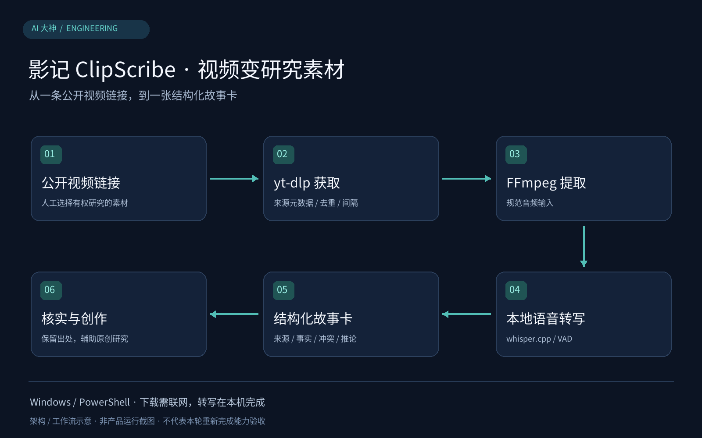

<div align="center">

# 影记 ClipScribe：本地短视频转写与故事卡流水线 · douyin-story-pipeline

**输入公开视频链接，在 Windows 本机自动完成限速下载、whisper.cpp 离线转写与结构化故事卡生成。**

</div>

面向 Windows 的多平台公开视频素材研究工具。提供图形启动器（YingJiClipScribe.exe）与 PowerShell 脚本双入口，串联 yt-dlp 元数据及视频获取、FFmpeg 音频提取、本地语音转写与 Markdown 故事分析卡生成。



> 图8：影记 ClipScribe (douyin-story-pipeline) 本地限速采集、whisper.cpp离线转写与故事卡生成管线示意图（基于脚本工作流绘制，非GUI实机截图）

## 它如何工作

面向多平台公开短视频叙事结构研究，构建一套在Windows本地闭环运行的低侵扰采集、离线语音转写与结构化故事拆解管线。系统以PowerShell核心脚本驱动（外层辅以轻量GUI启动器`YingJiClipScribe.exe`），读取`urls.txt`后调用本地`yt-dlp`按严格速率限制拉取公开视频及元数据；随后通过FFmpeg剥离音轨，交由本地`whisper.cpp`配合Silero VAD模型做纯离线中文语音识别，最终将台词、来源元数据与叙事分析维度（事实、冲突、推论、改编方案）组装为标准Markdown故事卡。

## 核心技术与工程取舍

| 技术机制 | 为什么这样做 |
| --- | --- |
| 批次限制、随机请求间隔与下载归档 | 单轮有数量上限并在请求间等待，archive记录帮助去重；这是保守采集策略，不保证平台永不限制请求。 |
| whisper.cpp (ggml量化模型) + Silero VAD纯本地转写 | 本地模型和 VAD 承担转写，减少云端识别依赖；下载仍需网络，准确度和速度取决于音频、模型与电脑性能。 |
| EXE薄壳启动器与PowerShell业务脚本分离架构 | 既满足普通用户双击图形界面一键运行的需求，又避免单文件自解压EXE每次退出时丢失内置缓存，同时让开发者能直接审计和热修改底层`.ps1`处理逻辑。 |
| 四维分离式Markdown故事卡（事实/冲突/推论/改编） | 把来源、事实、冲突、推论和改编思路分栏，给后续核验与创作提供框架；卡片不自动等于事实已核实。 |

## 一个具体使用场景

创作者从50条公开视频中人工筛选3条写入`urls.txt`，双击`YingJiClipScribe.exe`点击开始处理：程序间隔20余秒依次调用`yt-dlp`下载至`data/raw/`，经FFmpeg与`whisper-cli.exe`离线生成转写稿，并在`data/cards/`输出带冲突分析框架的Markdown卡片。

## 从这里开始

```powershell
Copy-Item .\urls.example.txt .\urls.txt
powershell.exe -NoProfile -ExecutionPolicy Bypass -File .\run.ps1
```

先按 [USAGE.md](USAGE.md) 准备 Windows 本地工具；在 `urls.txt` 放入有权研究的公开视频链接。输出位于 `data/raw/`、`data/transcripts/` 与 `data/cards/`。

## 实现与验证范围

已完整实现Windows 10/11下基于PowerShell与`.tools`本地工具链（yt-dlp/FFmpeg/whisper.cpp）的下载、归档去重、离线转写、故事卡生成及EXE打包脚本；仅支持无需登录/验证码的公开视频，平台兼容性随上游`yt-dlp`提取器状态动态变化。

## 许可证与依赖

见 [LICENSE](LICENSE)。第三方工具、模型及素材保留各自的许可与权利边界。
